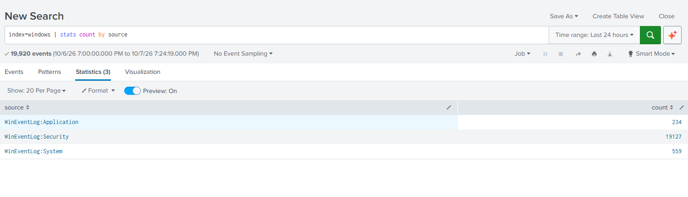
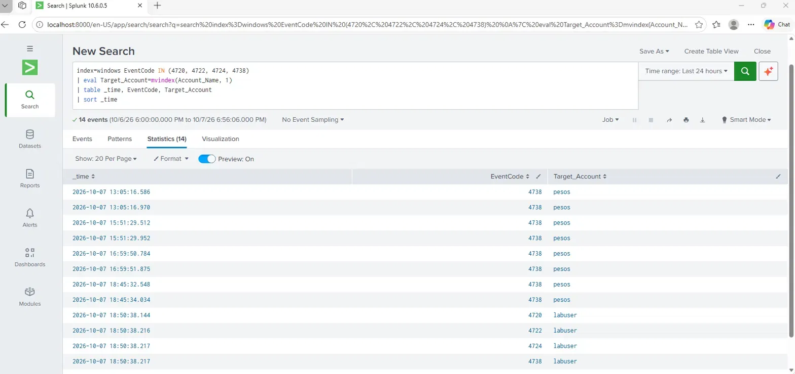
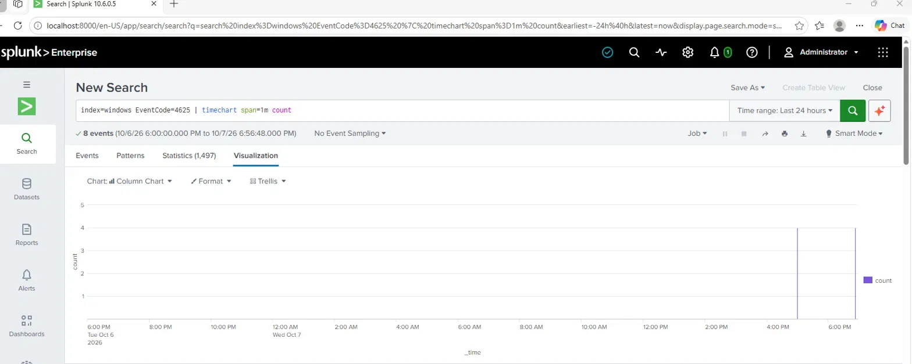
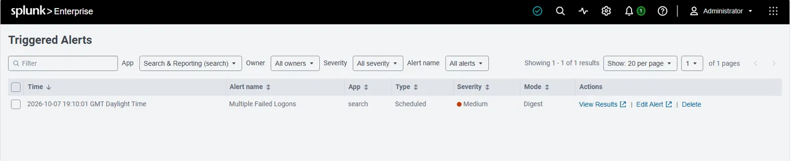

# Splunk Session 1: Windows Event Logs and Failed Logon Detection

**Tool:** Splunk Enterprise 10.6

**Date:** 07/10/2026

## Scope and Environment

All activity took place inside an isolated Windows 11 Pro virtual machine running in VMware Workstation. The failed logons and account creation were generated deliberately by me on my own lab machine to produce realistic security events for analysis.

| Component | Detail |
|---|---|
| Host | Windows 11 Pro VM (hostname `Lab`) |
| SIEM | Splunk Enterprise 10.6, 60 day trial licence |
| Data sources | Windows Event Logs: Application, Security, System |
| Index | `windows` |

## Summary

I installed Splunk, ingested local Windows event logs into a dedicated index, simulated a brute force attempt against a local account, investigated the resulting events, and built a scheduled alert that successfully detected the activity. Along the way I found and worked around a logging visibility gap with PIN based sign in.

## What I Did

### 1. Installation and data ingestion

I installed Splunk Enterprise on the VM using a **Virtual Account**, which allows Splunk to read local event logs. Splunk runs as a background service and is accessed through a browser at `localhost:8000`.

I added the Application, Security and System logs through **Settings > Add Data > Monitor > Local Event Logs** and sent them to a new index called `windows` instead of the default `main` index, as separating data by index is standard practice.

My first search returned no results because Splunk only searches the default index unless told otherwise. Specifying the index fixed this:

```
index=windows
```

I confirmed all three logs were being collected:

```
index=windows | stats count by source
```



The Security log produced roughly 19,000 events in 24 hours compared with a few hundred for Application and System, showing how noisy Security logging is and why tuning matters in a real SOC where SIEM licensing is often priced by data volume.

### 2. Simulating a brute force attempt

I locked the VM and entered the wrong password several times, then searched for failed logons (Event ID **4625**):

```
index=windows EventCode=4625 | stats count by Account_Name
```

The results showed only `-` and `LAB$` rather than a username. Investigating the raw events showed that each 4625 event contains two account sections: the **Subject** (the machine handling the logon, shown as `LAB$`) and the **Account For Which Logon Failed** (the targeted user). Splunk extracts both into one multivalue field, so I used `mvindex` to pull out the second value:

```
index=windows EventCode=4625
| eval Target_User=mvindex(Account_Name, 1)
| stats count by Target_User, Failure_Reason
```

The targeted username was still blank. I found that this was because I signed into the VM with a **Windows Hello PIN linked to a Microsoft account**, and those failures are logged without the account name and with only a generic reason.

### 3. Creating a local test account

To produce realistic data, I created a local account with a standard password from an administrator terminal:

```
net user labuser Password123! /add
```

Failed logons against this account were fully visible:

| Target_User | Failure_Reason | count |
|---|---|---|
| `-` | An Error occurred during Logon. | 4 |
| `labuser` | Unknown user name or bad password. | 8 |

The `labuser` count of 8 covers two rounds of 5 wrong passwords: the initial test and the later alert test.


### 4. Investigating the account creation

Creating `labuser` generated an Event ID **4720** (user account created), showing my account `pesos` as the creator and `labuser` as the new account. The event listed the account as disabled with no password required, which initially looked suspicious. Searching related events showed why:

```
index=windows EventCode IN (4720, 4722, 4724, 4738)
| eval Target_Account=mvindex(Account_Name, 1)
| table _time, EventCode, Target_Account
| sort _time
```



Windows creates an account in stages: 4720 (created as a disabled shell), 4722 (enabled), 4724 (password set) and 4738 (changed), all within the same second. This sequence is the fingerprint of an account created in one command. The same search also showed pairs of 4738 events on my own account at each sign in, which is routine background activity and a useful baseline to compare unusual events against.

### 5. Visualising the activity

```
index=windows EventCode=4625 | timechart span=1m count
```

Displayed as a column chart over 24 hours, the two failed logon bursts (the PIN attempts around 17:00 and the `labuser` attempts around 18:50) appear as spikes against a flat baseline.



### 6. Building and testing an alert

I saved the failed logon search as a scheduled alert:

| Setting | Value |
|---|---|
| Title | Multiple Failed Logons |
| Search | `index=windows EventCode=4625` |
| Schedule | Cron `*/5 * * * *` (every 5 minutes) |
| Time range | Last 5 minutes |
| Trigger condition | Number of results greater than 3 |
| Action | Add to Triggered Alerts, severity Medium |

The time range and schedule were deliberately matched. If the alert ran every 5 minutes but looked back further, the same events would trigger it repeatedly and create duplicate alerts.

To test it, I entered 5 wrong passwords for `labuser` at about 19:06. The 19:10 scheduled run found 4 failed logons between 19:05 and 19:10 and triggered the alert.



## What I Found or Learned

* **A full detection pipeline works end to end:** Windows logs the event, Splunk ingests it, a scheduled search evaluates it, and an alert fires when a threshold is crossed. This is the core of detection engineering in a SOC.
* **Default field extractions can mislead.** `Account_Name` on 4625 events contains two values, and taking the first would have pointed an analyst at the wrong account. Checking the raw event before trusting a result is essential.
* **Log quality depends on authentication method.** PIN based Microsoft account failures were logged with no username and a vague reason, a real visibility gap that an analyst would need to cover by correlating with other data sources.
* **Context matters before raising concern.** A newly created account appearing as disabled with no password required looks alarming in isolation, but related events showed it was normal Windows behaviour.
* **Knowing what normal looks like** (such as routine 4738 events at sign in) makes unusual activity stand out.
* Typing 5 wrong passwords consistently produced 4 logged 4625 events, likely due to lock screen behaviour, which shows why alert thresholds should allow for small variations.

**MITRE ATT&CK mapping:** the simulated activity relates to **T1110 Brute Force** and **T1136.001 Create Account: Local Account**.

**Key Windows Event IDs:**

| Event ID | Meaning |
|---|---|
| 4624 | Successful logon |
| 4625 | Failed logon |
| 4672 | Special privileges assigned to new logon (admin logon) |
| 4720 | User account created |
| 4722 | User account enabled |
| 4724 | Password reset attempt |
| 4738 | User account changed |

**Useful SPL learned:** `stats count by`, `table`, `sort`, `eval`, `mvindex`, `timechart`, `IN`, and the inline time modifier `earliest=-5m`.

## Notes for Later

* Break down Security log volume with `index=windows source="WinEventLog:Security" | stats count by EventCode | sort -count` to see which events generate the most noise
* Extend the alert to group by user so it shows which account is being targeted
* Install **Sysmon** for much richer endpoint visibility, including process creation and network connections
* Attack the VM from **Kali Linux** (for example, a network brute force) and compare how it appears in the logs versus a local attempt
* Build a simple dashboard for logon activity
* Note that alerting is disabled when the trial converts to Splunk Free after 60 days
